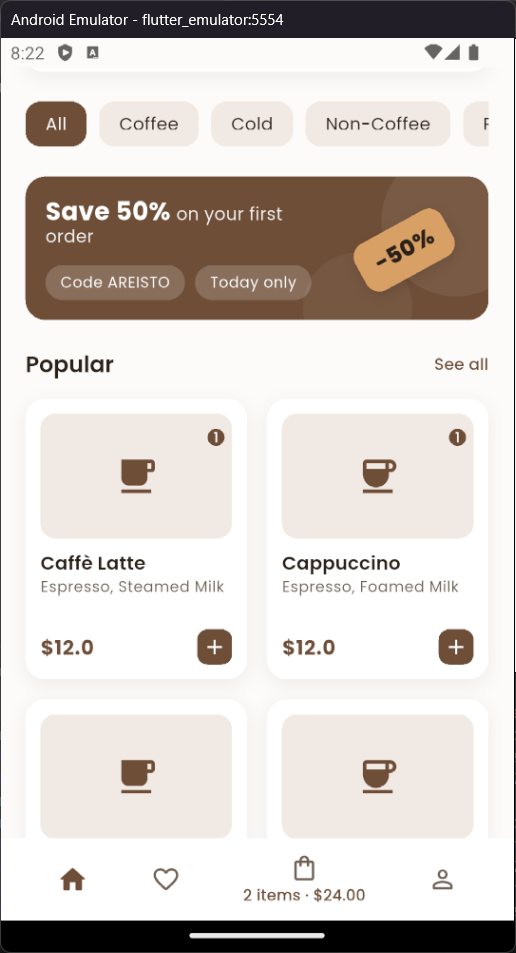
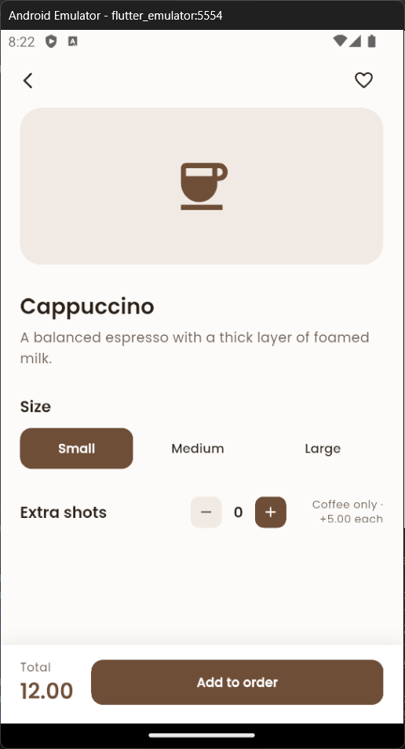
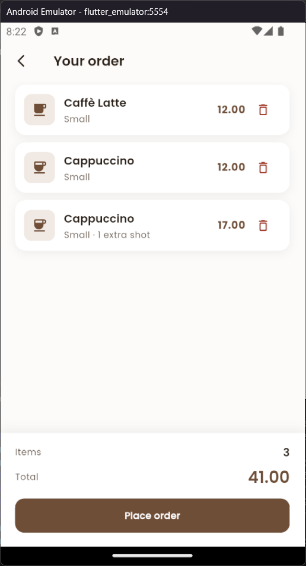
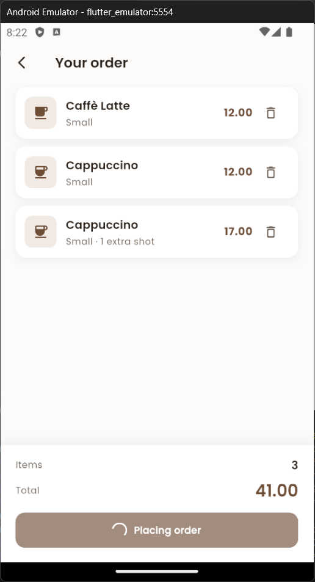
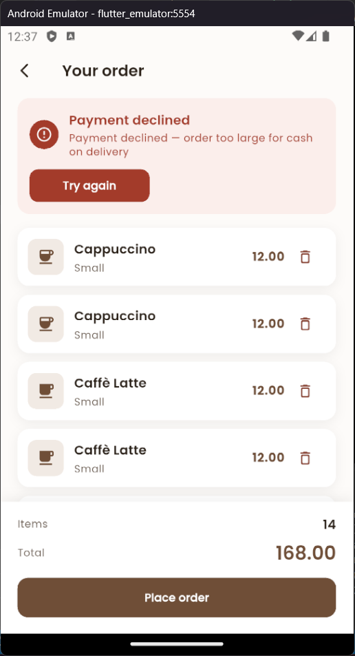

# Coffee App — Project 1

A three-screen Flutter coffee ordering app: browse the menu, customise a drink (size and extra shots), review the cart, and place an order through a fake server that takes two seconds and sometimes fails. State is managed with `setState` only; the week 1 `Order`, `Drink` and `Coffee` classes drive everything.

## Screenshots

| Menu | Drink detail | Cart | Loading |Success|error|
|------|--------------|------|---------|-------|-----|
|  |  |  |  | ||


## How to run

```bash
cd project-01/coffee_app
flutter pub get
flutter run
```

Requires Flutter 3.x. Only external package: `google_fonts`.

**Testing the failure path:** open a large coffee with 3 extra shots (22.50 USD), add it 7 times so the total passes (150 USD), then tap **Place order**. The service throws, the error panel appears, and **Try again** is available.

## Features

- **Menu:** category filtering, empty state, tap a card to open details, `+` to add a default drink, bottom bar opens the cart.
- **Detail:** size (small / medium / large), extra shots (0–3, coffee only), live price, **Add to order**. Sold-out drinks open normally but the button is disabled.
- **Cart:** each item with size and shots, per-row remove, item count, total, empty state with a way back, **Place order** disabled when empty.
- **Checkout:** four states — idle, loading (spinner + button locked), success (order number, cart cleared), failure (message + retry).

## Architecture

```
lib/
├── main.dart                 # MaterialApp + theme
├── theme.dart                # all colours and text styles, incl. success / error / disabled tokens
├── menu_screen.dart          # owns the Order and the selected category
├── drink_detail_screen.dart  # collects size + shots, builds the configured Drink
├── cart_screen.dart          # cart list + checkout state machine
├── models/
│   ├── drink.dart            # DrinkSize (multiplier), Drink, Coffee (+5 USD per shot)
│   └── order.dart            # items, total, add / remove / clear
├── services/
│   └── fake_order_service.dart   # provided file, unchanged
├── data/drink_data.dart      # sample menu
└── widgets/                  # menu widgets (DrinkCard, DrinkGrid, BottomBar, ...)
```

**Where the order lives:** a single `Order` instance is created in `_MenuScreenState`. It is passed to the cart screen through the constructor, and the detail screen receives an `onAdd` callback that adds to it. After a change, `setState` in the menu refreshes the item count and total in the bottom bar. I kept it there because the menu is the one screen that is always in the stack underneath the others, so it outlives both.

**Where prices are calculated:** only in the model. `DrinkSize.multiplier` holds 1.0 / 1.25 / 1.5 and `Coffee.price` adds 5 EGP per shot. The detail screen only collects choices and builds a `Coffee` with `copyWith`; it never does arithmetic.

**Checkout flow:** `_placeOrder` in `cart_screen.dart` sets `_isPlacingOrder`, awaits `FakeOrderService.placeOrder` inside `try/catch`, and checks `mounted` before every `setState` that follows the `await`. The button is `null` (disabled) while loading, and `_placeOrder` returns early if it is already running, so a double tap cannot send two requests.


## What I learned

The thing that confused me most was `await`. I thought it would freeze the whole app while it waited, but it only pauses the function it is inside. The rest of the app, like the spinner and the screen, keeps running. It clicked when I saw that `_placeOrder` stops at the `await` line, the spinner keeps spinning, and then the function continues when the Future finishes.

The second thing was `setState` after an `await`. The screen can be closed while the app is waiting, so I now check `mounted` before every `setState` that comes after an `await`. I also learned to set `_isPlacingOrder = true` before the `await`, so a second tap cannot start a second request.

## What I'd do next

- **Quantity stepper in the cart:** change the remove-only button to `-` and `+`, so users can change the number of each drink.
- **Confirmation dialog:** ask "Are you sure?" before placing the order.
- **Save the order:** keep the cart after the app closes, so the user does not lose it.